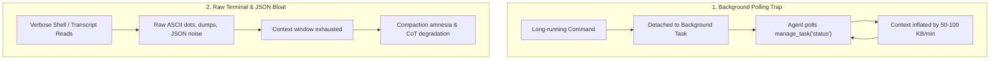

# Overview & Motivation

**Agy-Context-Saver** is a CLI-first transcript forensic engine and lifecycle governor engineered specifically for **Google Antigravity** (`agy`), paired with **RTK (Rust Token Killer >= 1.1.0)** for transparent command output reduction.

It eliminates session degradation, memory leaks, and context window exhaustion caused by **background task busy-wait polling**, **terminal output bloat**, **native inspection bypasses**, and **raw transcript reading**.

---

## Quickstart

Install and activate the governor across your Antigravity environment in seconds:

=== "NPX (Recommended)"
    ```bash
    npx --package=agy-context-saver agy-context setup
    ```

=== "Local Setup"
    ```bash
    npm run setup
    ```

=== "Audit Status"
    ```bash
    agy-context status
    ```

!!! success "Enterprise Non-Destructive Guarantee"
    Installing `Agy-Context-Saver` is 100% non-destructive and zero-churn:
    - **Zero Runtime Dependencies**: Built entirely with native Node.js standard library; 0 external npm dependencies.
    - **Foreign Hook & MCP Preservation**: Existing third-party hooks (e.g. `waymark-continuity`) and external MCP servers are strictly preserved, while legacy `agy-context-saver*` MCP schemas are cleanly swept.
    - **Automatic Atomic Backups**: Creates timestamped `.bak` configuration backups before any edit.
    - **One-Command Rollback**: Clean uninstallation via `agy-context uninstall` or `agy-context uninstall --restore-backups`.

---

## Why Agy-Context-Saver + RTK?

`Agy-Context-Saver` leverages the **open Model Context Protocol (MCP)** specification alongside native Antigravity lifecycle hooks, integrating seamlessly with RTK:

- **RTK owns command optimization**: Supported shell commands are transparently rewritten via `rtk rewrite` before execution, yielding 60–90% token reduction across git, pytest, cargo, npm, docker, and linters.
- **Agy owns Antigravity integrity**: Hard-routes native inspection tools to canonical RTK shell commands, enforces Reactive Wakeup, blocks direct access to internal `.system_generated` state, and provides zero-JSON Markdown transcript extraction.

Any developer running Antigravity on macOS, Linux, or Windows can install and activate the governor immediately without external cloud dependencies.

---

## The Core Problems Solved



### 1. The Background Task Polling Trap
When an agent initiates a shell command exceeding `WaitMsBeforeAsync` (~5 seconds), Antigravity detaches the process into a background task (`task-XYZ`).
- **The Anti-Pattern**: Large Language Models exhibit an innate busy-waiting bias: they repeatedly invoke `manage_task(Action='status')` or schedule short timers rather than yielding execution to the native **Reactive Wakeup** system.
- **The Consequence**: Transcripts bloat rapidly, pushing critical user instructions and architectural constraints out of the attention window, degrading model reasoning and causing session stalls.
- **The Solution**: Agy's closed session ledger blocks repeated polling and enforces native Reactive Wakeup (`<SYSTEM_MESSAGE>`).

### 2. The Terminal Output Bloat Trap
- **The Problem**: Routine test runs, linters, and build commands dump thousands of repetitive pass lines and progress indicators into the transcript.
- **The Solution**: RTK transparently intercepts and optimizes commands via PreToolUse hooks, collapsing passes and preserving failures.

### 3. The Native Inspection Bypass Trap
- **The Problem**: Unbounded native file and search tools (`read_file` without bounds, `grep_search`, `find_by_name`, `list_dir`) bypass RTK command optimization.
- **The Solution**: Agy enforces bounded `read_file` slices (`StartLine` / `EndLine <= 150`, or explicit full-file audits $\le 800\text{L} / 45\text{ KiB}$) and routes directory/prose search and spillover reads to canonical RTK CLI interfaces (`rtk grep`, `rtk find`, `rtk ls`, `rtk read`).

### 4. The Raw Transcript Reading Trap
- **The Problem**: Direct `read_file` on `.system_generated/logs/transcript.jsonl` floods working memory with raw JSON syntax.
- **The Solution**: Agy blocks direct reads of `.system_generated` by root and provides streaming Markdown CLI subcommands (`agy-context transcript read|query|step|health`).

!!! note "Subagent tools moved to Agy-Squad"
    `subagent_brief` and squad dispatch moved to the separate [Agy-Squad](https://paragon-ux.github.io/agy-squad/) package. Agy-Context-Saver 2.0.0 runs CLI-first with zero MCP tool schema overhead and pairs cleanly with Agy-Squad.

---

## Core Value Proposition

| Metric / Feature | Without Governor | With Agy-Context-Saver + RTK |
| :--- | :--- | :--- |
| **Command Output Bloat** | Unlimited raw test dots, ANSI dumps | RTK `>= 1.1.0` transparent reduction via `rtk hook antigravity` |
| **Workspace File Inspection** | Massive uncompressed file dumps | `rtk grep` / `rtk find` $\to$ bounded `read_file` slices ($\le 150$ lines) |
| **Long Command Execution** | Detached after 5s $\to$ busy-wait loop | Synchronous window expanded to 10s when unset $\to$ finishes in-turn |
| **Background Task Monitoring** | Repetitive busy-polling loops | Enforced Reactive Wakeup with 5-strike circuit breaker |
| **Configuration Safety** | Risk of third-party config clobber | Non-destructive preservation of foreign hooks/MCP with `.bak` backups |
| **Transcript Review** | Raw JSONL dumped into context | Clean Markdown via `agy-context transcript read\|query\|step\|health` |
| **Runtime Dependencies** | N/A | **Zero** external npm dependencies (100% Node.js stdlib) + RTK binary |

---

## CLI Capabilities at a Glance

`Agy-Context-Saver` v2.0.0 exposes a zero-overhead CLI installed into `~/.gemini/antigravity/bin/agy-context`:

* **Transcript Forensics & Health**:
  - [`agy-context transcript health`](tools.md#1-agy-context-transcript-health): Diagnoses transcript turn counts, payload size, RTK status, and polling loops.
  - [`agy-context transcript read`](tools.md#2-agy-context-transcript-read): Streams recent conversation history in clean Markdown format.
  - [`agy-context transcript query`](tools.md#3-agy-context-transcript-query): Forensic filtering and regex search engine with truncated-tail dereferencing.
  - [`agy-context transcript step`](tools.md#mode-c-surgical-step-dereferencing-agy-context-transcript-step): Surgically extracts untruncated `content`, `thinking`, or `tool_args` for a single step.
* **Installation & Status**:
  - [`agy-context status`](tools.md#4-agy-context-status) & [`setup`](tools.md#5-agy-context-setup-uninstall): Audits or repairs the plugin link, hook, CLI shim, RTK `>= 1.1.0`, and legacy MCP cleanup.

See the complete [Tool & Prompt Reference](tools.md) for parameter details and usage examples.
