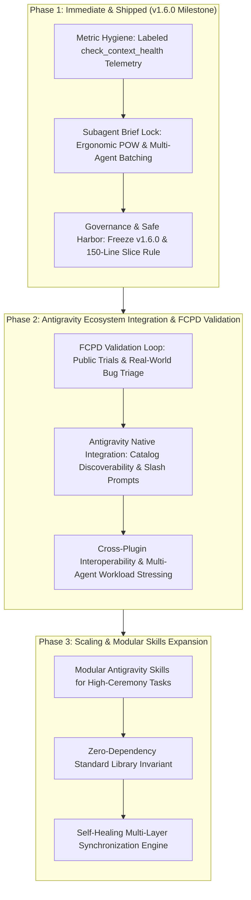

# Agy-Context-Saver Product Roadmap

**Document Version:** 1.1.0  
**Effective Date:** October 2026  
**Status:** Approved Architecture & Product Strategy  
**Owner:** Core Engineering (`paragon-ux`)  
**Product Methodology:** Full Cycle Product Development (FCPD)

---

## 1. Vision & Core Identity

**Agy-Context-Saver** is the foundational Context Window Preservation, Token Economics, and Execution Governance framework purpose-built for affordable and reliable multi-agent use across Google Antigravity.

Applying the principles of **Full Cycle Product Development (FCPD)**, the product moves through a disciplined progression:
- **Prototype / PoC**: Proven core hook interception and RTK token compression. *(Completed)*
- **MVP Hardening**: Zero-dependency MCP server, 6 canonical tools, closed execution topology, and 150-line safe-harbor slice rule. *(Shipped in v1.6.0)*
- **Product-Market Fit (PMF) & Validation**: Public validation, real-world bug triage, Antigravity ecosystem integration, and telemetry refinement. *(Active Phase)*
- **Scaling & Ecosystem**: Modular skills expansion, high-throughput multi-agent orchestration, and enterprise-grade lifecycle resilience. *(Forward Roadmap)*

### What Agy-Context-Saver IS
1. **Context Window Shield:** Prevents conversational context degradation and token exhaustion by offloading verbose shell and filesystem operations to RTK (Rust Token Killer).
2. **Execution Governor:** Enforces closed execution topology, eliminates runaway polling loops (`manage_task status`), protects Antigravity internal state (`.system_generated/`), and guarantees synchronous command execution (`WaitMsBeforeAsync`).
3. **Ergonomic Lifecycle & Diagnostics:** Provides lightweight MCP tools (`check_context_health`, `read_transcript`, `query_transcript`, `get_installation_status`, `sync_installation`) with zero external runtime dependencies. Subagent tooling lives in the separate [Agy-Squad](https://paragon-ux.github.io/agy-squad/) package.

### What Agy-Context-Saver is NOT (Explicit Non-Goals & Anti-Patterns)
- **NOT an Issue Tracker or Bug Ledger:** We will not bloat the engine with finding-to-disposition state machines (`FIXED_AND_VERIFIED`, `REJECTED`, `OPEN`) or Jira-style workflows. High-ceremony ledgers belong in task-specific prompt templates or Antigravity skills.
- **NOT a Virtual Filesystem Hypervisor or Chroot Sandbox:** We will not implement brittle, platform-dependent filesystem jails or artificial blinding mechanisms; task isolation belongs to container boundaries or benchmark fixtures.
- **NOT a Citation or Plagiarism Auditor:** We will not build academic claim verifiers or fact-checking engines into the core product.
- **NOT an Overfitted Coding-Only Tool:** While coding workflows are a premier use case, context preservation, token economics, and closed execution governance apply equally to research, operations, analysis, and document drafting.

---

## 2. Phased Strategic Roadmap

---

### Phase 1: Immediate & Shipped (v1.6.0 Milestone)

**Objective:** Deliver rock-solid context governance, transparent diagnostic telemetry, and zero-overhead subagent brief formulation with 100% test verification.

#### 1.1 Metric Hygiene & Labeled Diagnostics *(Shipped)*
- **Problem:** Lifetime machine-wide counters reported by `rtk gain` were occasionally conflated with single-session or per-task token savings.
- **Implementation:** 
  - Restructured `check_context_health` with explicit labeled sections:
    - `#### [Active Session Metrics]` (Steps, User Turns, Assistant Responses, Tool Calls, Raw Transcript Size, Busy-Polling Events).
    - `#### [Local RTK Environment]` (Binary status, installed version, explicit scoping note).
  - Documented metric distinction across `README.md`, `docs/governance.md`, and `docs/tools.md`.
- **Status:** Shipped and verified in `v1.6.0`.

#### 1.2 Decouple Benchmark Scratch Fixes from Core Code *(Shipped)*
- **Problem:** Synthetic test service quirks (e.g. default fallback tokens or generator directory locations) risk inducing speculative checks or benchmark-overfitted logic in product code.
- **Implementation:**
  - Kept all benchmark-specific corrections isolated to benchmark suites (`antigravity-orchestration-suite`) or scratch directories.
  - Strictly prohibited synthetic gate rules in production hooks or MCP tools.
- **Status:** Shipped and verified in `v1.6.0`.

#### 1.3 Freeze Core Governance & Safe Harbor *(Shipped)*
- **Problem:** Frequent changes to execution hooks risk disrupting active agent interactions.
- **Implementation:**
  - Bounded line slice safe harbor: permitted targeted inspections via `view_file` ($\le 150$ lines) while hard-routing oversized inspections to `rtk read`.
  - Maintained root-level protection of `.system_generated/` (transcripts and active task logs).
  - Preserved synchronous execution window expansion (`WaitMsBeforeAsync=10000`).
- **Status:** Shipped and verified in `v1.6.0`.

#### 1.4 Subagent Brief Lock & Multi-Role Batching *(Shipped)*
- **Problem:** Feature creep pressure to turn `subagent_brief` into an issue tracker or evaluation judge.
- **Implementation:**
  - Locked schema to its core purpose: generating scope-isolated prompts and turnkey `invoke_subagent` payloads under the Pointer-Over-Wire (POW) protocol.
  - Added native multi-role batch support (`subagents` array) with role, model, and workspace customizability.
- **Status:** Shipped and verified in `v1.6.0`. Moved to the separate Agy-Squad package on 2026-10-15.

#### 1.5 Cross-Platform Execution Guard Stability *(Shipped)*
- **Problem:** Differences between POSIX shells and Windows PowerShell can introduce command rewriting stalls or quote mismatches.
- **Implementation:**
  - Hardened command unwrapping (`cmd /c`, `powershell -Command`) and trailing dot requirements for Windows (`rtk rg "<pattern>" .`).
  - Automated regression testing across Windows and POSIX in 8 test suites (`npm test`).
- **Status:** Shipped and verified in `v1.6.0`.

---

### Phase 2: Antigravity Ecosystem Integration & FCPD Validation

**Objective:** Execute Full Cycle Product Development (FCPD) principles during open public trials, systematically triaging developer feedback, resolving edge-case bugs, and embedding Agy-Context-Saver natively into the Antigravity ecosystem.

#### 2.1 Full Cycle Public Validation & Bug Triage Loop
- **Problem:** Real-world developer usage across different Antigravity versions and model backends surfaces unexpected corner cases (e.g. specialized CLI flags, deep subagent nesting, non-standard project layouts).
- **Action:**
  - Establish an agile feedback-to-patch loop: collect diagnostic reports from public users running `npm run status` and `check_context_health`.
  - Prioritize rapid triage and remediation of real-world workflow frictions over theoretical optimizations.
  - Continually validate against emerging Antigravity agent models and core CLI releases.
- **Success Criteria:** Sub-48h triage and remediation cycle for confirmed real-world compatibility issues; 100% backward-compatible patch releases.

#### 2.2 Deep Antigravity Ecosystem & Plugin Distribution
- **Problem:** Manual installation friction or lack of discoverability limits developer adoption.
- **Action:**
  - Ensure zero-friction one-click installation via Antigravity's first-class plugin registry and CLI (`npx agy-context-saver install`).
  - Maximize in-editor discoverability through user slash commands (`/mcp:agy-context-saver:context_shield`) and IDE suggested prompts in `plugin.json`.
  - Integrate with Antigravity UI panels and sidecars where visual telemetry adds developer value.
- **Success Criteria:** Zero-friction installation on clean Antigravity installs; instant activation via slash commands.

#### 2.3 Cross-Plugin Interoperability & Multi-Agent Workload Stressing
- **Problem:** Co-existence with other Antigravity plugins (e.g., `waymark-engine`, Chrome DevTools MCP) must never suffer from hook contention or clobbered configurations.
- **Action:**
  - Validate multi-plugin setups with foreign hooks (`hooks.json`) and external MCP servers (`mcp_config.json`).
  - Stress-test heavy multi-agent workflows (development, security audits, data forensics, technical documentation drafting) to guarantee zero hook deadlock or latency degradation.
- **Success Criteria:** Zero clobbered foreign configs during install/sync/uninstall; sub-5ms hook overhead under concurrent multi-agent load.

---

### Phase 3: Scaling & Modular Skills Expansion

**Objective:** Scale the framework to complex enterprise workflows by offering modular, task-specific Antigravity skills while preserving a lean, unopinionated core.

#### 3.1 Modular Antigravity Skills for High-Ceremony Tasks
- **Problem:** Compliance audits, bug bounties, and competitive benchmarks often require formal finding ledgers, double-blind evaluation harnesses, or citation registers. Embedding these in the core engine creates bloat and breaks generalist use.
- **Action:**
  - Package high-ceremony workflows into standalone Antigravity **skills** (e.g. `audit-ledger-skill`, `blind-eval-skill`).
  - Users and agents trigger these skills on demand via `/skill` or prompt activation without adding any code to `Agy-Context-Saver`.
- **Success Criteria:** 100% separation of concerns; advanced workflows supported modularly with zero bloat to the core engine.

#### 3.2 Uncompromising Zero-Dependency Core
- **Problem:** External npm runtime dependencies introduce supply-chain vulnerabilities, install bloat, and platform breakages.
- **Action:**
  - Maintain the zero runtime dependency invariant: pure Node.js standard library (`fs`, `path`, `os`, `readline`, `child_process`).
  - Memory footprint ceiling: MCP server must remain $< 30\text{ MB}$; hook evaluation must remain $< 5\text{ ms}$.
- **Success Criteria:** 100% offline functionality, instantaneous installation, zero security advisory churn.

#### 3.3 Self-Healing Multi-Layer Synchronization Engine
- **Problem:** Manual configuration file edits or external plugin changes can desynchronize hooks or MCP settings.
- **Action:**
  - Expand `sync_installation` to detect and repair configuration drift autonomously.
  - Automatically maintain timestamped `.bak` backups before modifying any configuration file.
- **Success Criteria:** Fully deterministic, self-healing runtime with one-click recovery.

---

## 3. Decision Matrix: Proposal Falsification Ledger

| Proposed Concept (External Assessment) | Core Fit? | Verdict | Rationale & Architectural Boundary |
| :--- | :---: | :---: | :--- |
| **O-001 / O-005: Finding-to-Disposition Ledgers** | ❌ No | **REJECT (Engine)** *(Skill Optional)* | Over-engineers a context plugin into a bug tracker. High-ceremony finding tracking belongs in task-specific prompt templates, not core code. |
| **O-002: Security Veto Gates** | ❌ No | **REJECT (Engine)** | Imposing security-specific completion blocks globally breaks generalist workflows (drafting, research, prototyping). |
| **O-003 / O-007: Enforced Blind-Workspace Jails** | ❌ No | **REJECT** | Agy-Context-Saver is an MCP plugin, not an OS hypervisor. Real-world agents require shared project access. Benchmark blinding belongs in test fixture design. |
| **O-004: Claim-Level Citation Verifiers** | ❌ No | **REJECT** | Orthogonal to context optimization and command rewriting. Belongs in specialized research agent prompts. |
| **O-008: Auditable Execution Provenance** | ⚠️ Partial | **ADOPT (Lightweight)** | Maintain clean, operational health metrics via `check_context_health` and transcript tools without heavy telemetry bloat. |
| **O-016: Scoped Efficiency Metrics** | ✅ Yes | **ADOPT (v1.6.0)** | Essential hygiene: Clearly delineate between active session transcript bytes and cumulative host RTK tokens saved. |

---

## 4. Governance & Versioning Commitment

- **Semantic Versioning:** Backward-incompatible API or schema changes will strictly trigger major version bumps.
- **Performance Budget:** Hook execution overhead must remain $< 5\text{ ms}$; MCP tool memory footprint must remain $< 30\text{ MB}$.
- **Test Integrity:** Every commit must pass all automated test suites (`npm test`).
