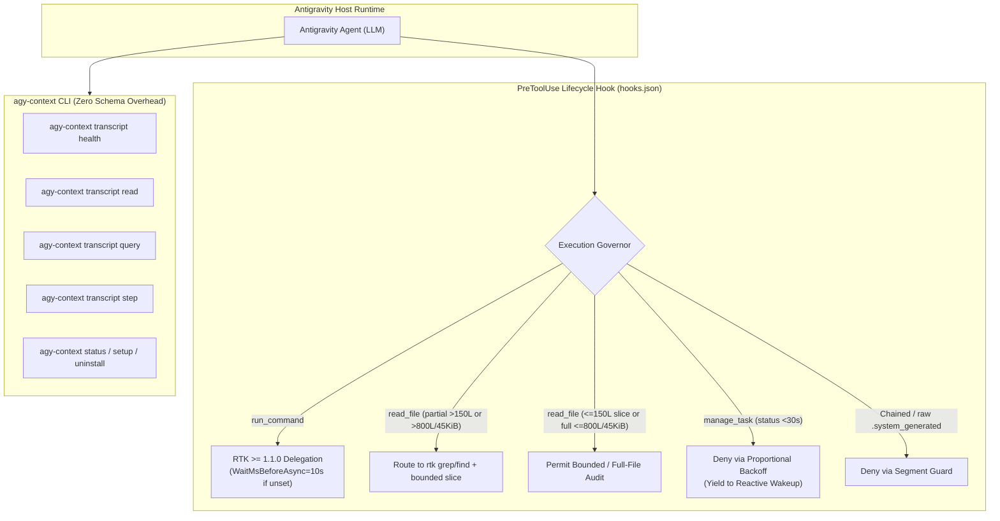
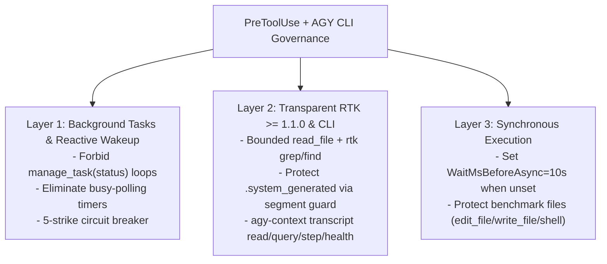

# CLI & Hook Reference (`v2.0.0`)

`Agy-Context-Saver` v2.0.0 provides a zero-dependency **CLI (`agy-context`)** and single-source **PreToolUse lifecycle hook (`agy-context-saver`)** engineered for **Google Antigravity 2.0**, paired with **RTK (Rust Token Killer >= 1.1.0)**. Default MCP server registration was retired in `v2.0.0` so tool schemas consume 0 tokens per conversation.

---

## Architectural Division of Responsibilities



The system divides operational responsibilities cleanly:
- **RTK (`>= 1.1.0`)**: Compresses terminal outputs via `rtk hook antigravity` (`rtk git`, `rtk pytest`, `rtk cargo`) and executes workspace inspection (`rtk grep`, `rtk find`, `rtk ls`, `rtk read`).
- **Agy-Context-Saver (`v2.0.0`)**: Governs lifecycle turns, prevents runaway polling loops, provides streaming zero-JSON transcript forensics via `agy-context`, and verifies environmental health. (Subagent orchestration lives in the separate [Agy-Squad](https://paragon-ux.github.io/agy-squad/) package.)

---

## Unified 3-Tier Codebase & File Inspection

Unbounded native inspection tools (`read_file` without slices, `view_file`, `grep_search`, `find_by_name`, `list_dir`) bypass token filtering and dump raw text into model context. The `Agy-Context-Saver` PreToolUse hook enforces a 3-tier inspection hierarchy:

| Tier / Native Tool | Target / Arguments | Canonical Governed Workflow | Token Savings |
| :--- | :--- | :--- | :---: |
| **Tier 1: Search & Discovery** | Pattern or directory discovery | `rtk grep "<pattern>" <path>` / `rtk find <path>` / `rtk ls <path>` | **75–95%** |
| **Tier 2: `read_file` (Default Slice)** | Bounded slice (`1–150` lines) | Permitted directly with 1-indexed line numbers for `edit_file` / `write_file` | **80–93%** |
| **Tier 2: `read_file` (Full-File Audit)** | Explicit `StartLine: 1, EndLine: <TotalLines>` on files $\le 800$ lines and $\le 45\text{ KiB}$ | Permitted for justified single-pass medium-file audits; partial slices of `151–800` lines are denied | **3$\times$ vs multi-turn slices** |
| **Tier 3: Spillovers & Logs** | `.system_generated/steps/<step>/output.txt` & completed `tasks/<taskId>.log` | Bounded `read_file` ($\le 150\text{L}$) on step spillovers or single unchained `rtk read <path>` | **60–85%** |

!!! tip "Hybrid Slice & Safe Harbor"
    Locate exact `[StartLine, EndLine]` spans first via `rtk grep "<pattern>" <path>`, then pass bounded slices into `read_file` (`1–150` lines default, or explicit `1..TotalLines` when auditing an entire file $\le 800$ lines and $\le 45\text{ KiB}$). Antigravity special files (`SKILL.md`, `AGENTS.md`, brain artifacts, `.gemini/config/`) pass Safe Harbor directly.

---

## 1. `agy-context transcript health`

Inspects a conversation trajectory (`transcript.jsonl`) via streaming chunk readers to audit turn count, payload weight, busy-polling loops, RTK `>= 1.1.0` status, and context degradation risk.

### Flags Reference

| Flag | Value | Required | Description |
| :--- | :---: | :---: | :--- |
| `--id` | `<uuid>` | No* | Target conversation UUID. (*Required when `>= 2` active `/swarm` sessions ran in the last 5 min.) |
| `--file` | `<path>` | No | Explicit path to `transcript.jsonl`. |
| `--json` | — | No | Emit structured JSON output instead of Markdown. |

### Example Invocations

```bash
agy-context transcript health
agy-context transcript health --id 68cbb7bc-ce63-4be7-accb-b0e3d37f8ecc
agy-context transcript health --id 68cbb7bc-ce63-4be7-accb-b0e3d37f8ecc --json
```

### Structured Output Format

The output is structured into two explicitly labeled sections to eliminate metric ambiguity:

```markdown
### Context Health Report: HEALTHY

#### [Active Session Metrics]
- Total Steps: 332
- User Turns: 4
- Assistant Responses: 82
- Tool Calls: 242
- Detected Busy-Polling Events: 0
- Legal Backoff-Compliant Checks/Watchdogs: 0
- Approximate Raw Transcript Size: 870.9 KB

#### [Local RTK Environment]
- RTK Command Optimizer: Active (rtk 1.1.0)
- Note: Lifetime token gains from 'rtk gain' represent cumulative machine-wide host savings, not single-session metrics.

✓ Context footprint is well-managed.
```

### Diagnostic Triage Playbook

| Health Status | Trigger Condition | Operational Implication & Corrective Action |
| :--- | :--- | :--- |
| **`HEALTHY`** | Polling $= 0$, User turns $< 35$ | Context footprint is lean and well-windowed. Proceed normally. |
| **`WARNING`** | User turns $\ge 35$ | Turn budget approaching saturation. Summarize progress and continue in a fresh conversation to preserve context. |
| **`CRITICAL`** | Busy-polling events $> 3$ | Active runaway polling detected (`manage_task status` or tight watchdog timers). Immediately halt polling loops and yield execution to native Reactive Wakeup (`<SYSTEM_MESSAGE>`). |

---

## 2. `agy-context transcript read`

Streams conversation turns from Antigravity trajectory logs directly into clean, formatted Markdown dialogue without exposing raw JSON syntax or bloated transport wrappers.

### Flags Reference

| Flag | Value | Default | Description |
| :--- | :---: | :---: | :--- |
| `--id` | `<uuid>` | Active / auto | Target conversation UUID. |
| `--mode` | `compact \| full` | `compact` | Format mode: `compact` (`transcript.jsonl`) or `full` (`transcript_full.jsonl`). |
| `--last-turns` | `<N>` | `3` | Number of most recent turns (`0` returns trailing bounded window up to 200 steps). |
| `--include-thinking` | — | `false` | Render extended thinking / chain-of-thought blocks. |
| `--file` | `<path>` | — | Explicit `.jsonl` transcript file path. |
| `--json` | — | `false` | Emit structured JSON output. |

### Example Invocation

```bash
agy-context transcript read --id 68cbb7bc-ce63-4be7-accb-b0e3d37f8ecc --last-turns 2 --mode compact
```

### Sample Output

```markdown
# Conversation Transcript: `68cbb7bc-ce63-4be7-accb-b0e3d37f8ecc`
- Mode: **compact**
- Showing last 2 turn(s)

---
### Turn 17: User
Check context health first, before we continue.

---
### Turn 18: Assistant
Audited context health: Active session is HEALTHY (0 busy-polling loops, 18 user turns).
```

### Operating Guidance: `compact` vs. `full`
- **Use `compact` (Default)**: Best for standard catch-up, peer agent review, and context summarization. Automatically skips unneeded payload dumps while keeping outputs fast and clean.
- **Use `full`**: Use only when inspecting raw outputs truncated in `compact`, paired with a tight `--last-turns` limit ($\le 2$) or `agy-context transcript step`.

---

## 3. `agy-context transcript query`

Multi-mode forensic search engine across conversation trajectories, supporting truncated-tail auto-dereferencing, role filtering, compact 1-line summaries, and step range bounds.

### Flags Reference

| Flag | Value | Default | Description |
| :--- | :---: | :---: | :--- |
| `--id` | `<uuid>` | Active / auto | Conversation UUID. |
| `--query` | `<regex>` | `""` | Case-insensitive regex or substring pattern to match. |
| `--roles` | `<csv>` | `user,assistant` | Comma-separated filter: `user`, `assistant`, `subagent`, `tool`, `error`, or `all`. |
| `--mode` | `auto \| compact \| full` | `auto` | `auto` checks `transcript.jsonl` and hydrates `truncated_fields` from `transcript_full.jsonl` when needed. |
| `--start` / `--end` | `<N>` | — | Inclusive `step_index` bounds. |
| `--last-turns` | `<N>` | — | Limit search window to the last N conversation turns. |
| `--limit` | `<N>` | `5` (`30` w/ `--summary`) | Maximum matching entries to return. |
| `--summary` | — | `false` | Render compact 1-line timeline bullets with `[ERROR]` and `[tools: ...]` tags. |
| `--include-tools` / `--include-thinking` | — | `false` | Include tool call arguments / thinking blocks. |
| `--json` / `--file` | — | — | JSON output or explicit transcript `.jsonl` file path. |

### Query Modes & Examples

#### Mode A: Keyword & Role Filtering
Search for structured errors or tool calls across history cleanly:

```bash
agy-context transcript query --id 68cbb7bc-ce63-4be7-accb-b0e3d37f8ecc --query "verification failed" --roles tool,assistant --limit 3
```

#### Mode B: Compact 1-Line Summary (`--summary`)
Provides ultra-dense timeline summaries for high-level orientation:

```bash
agy-context transcript query --id 68cbb7bc-ce63-4be7-accb-b0e3d37f8ecc --summary --limit 5
```

*Sample Output:*
```markdown
## Transcript Query Summary: `68cbb7bc-ce63-4be7-accb-b0e3d37f8ecc`
- [Step 1138] (assistant) Ran npm test across 11 test suites.
- [Step 1139] (tool) Full test suite passed 100%.
- [Step 1140] (assistant) Formulated roadmap synthesis.
```

#### Mode C: Surgical Step Dereferencing (`agy-context transcript step`)
When a compact transcript indicates `truncated_fields: ["content"]`, recover the exact field without reading adjacent steps:

```bash
agy-context transcript step --id 68cbb7bc-ce63-4be7-accb-b0e3d37f8ecc --step 1139 --field content
```

*Sample Output:*
```markdown
### Step 1139 Content:
ALL 11 AUTOMATED TEST SUITES PASSED 100%!
✓ test-hook.mjs
✓ test-transcript.mjs
✓ test-rtk-integration.mjs
```

---

## 4. `agy-context status`

Performs an instant live audit of all v2.0.0 integration layers, CLI shims, RTK `>= 1.1.0`, and legacy MCP cleanup:

```bash
agy-context status
```

*Sample Output:*
```markdown
Checking Agy-Context-Saver installation status...
- Native Plugin Link: ACTIVE (~/.gemini/config/plugins/agy-context-saver)
- Execution Governor Hook (agy-context-saver): ACTIVE (plugin hooks.json)
- CLI Shim (agy-context): INSTALLED (~/.gemini/antigravity/bin)
- RTK Command Optimizer (>= 1.1.0): INSTALLED (rtk 1.1.0)
- MCP Cleanup: CLEAN (0 duplicate MCP configs/schemas)
Overall Status: HEALTHY & ACTIVE
```

---

## 5. `agy-context setup` & `uninstall`

Programmatically reconciles, repairs, or cleanly uninstalls all integration layers (Plugin link, single-source hook activation, CLI shims, RTK configuration, and legacy MCP sweep):

```bash
agy-context setup [--check] [--allow-degraded]
agy-context uninstall [--restore-backups]
```

---

## Ephemeral Spillover & Task Log Safe Harbors (0 New Tools)

Rather than introducing redundant MCP tools that inflate schema overhead and induce LLM tool confusion, `Agy-Context-Saver` leverages canonical tools and CLI subcommands coupled with PreToolUse governance safe harbors:

### 1. Step Output Spillovers
When tool outputs exceed inline thresholds ($>24\text{ KB}$), Antigravity spills them to `.system_generated/steps/<step>/output.txt`.
- **Governance**: Bounded `read_file` (`StartLine`/`EndLine` $\le 150$ lines) and single unchained `rtk read <path>` invocations are allowed.
- **Optimization**: `rtk read` applies line windowing, head/tail clamping, and token reduction with zero manual configuration.

### 2. Completed Background Task Logs
When detached tasks finish, full logs reside in `.system_generated/tasks/<taskId>.log`.
- **While RUNNING**: Reading task logs is strictly **DENIED** under the Proportional Backoff curve, eliminating busy-polling loops.
- **When COMPLETED**: Inspecting completed task logs is safe-harbored via `rtk read tasks/<taskId>.log` via `run_command`, enabling post-mortem stack trace inspection.

### 3. Permanently Retired Legacy Tools
To eliminate tool schema overhead and agent confusion, legacy MCP tools and default MCP server registration are retired:
- **`safe_command`** *(Retired in v1.2.0)*: Replaced by transparent PreToolUse hook rewriting via `rtk hook antigravity` and synchronous window expansion to 10s when unset.
- **`get_spillover_content` & `read_task_output`** *(Retired in v1.5.0)*: Replaced by bounded `read_file` ($\le 150\text{L}$) on step spillovers and single unchained `rtk read` calls.
- **`get_step_detail`** *(Retired in v1.5.0)*: Replaced by `agy-context transcript step --id <conv> --step <N> --field <field>`.
- **Default MCP Registration** *(Retired in v2.0.0)*: Replaced by the zero-overhead `agy-context` CLI shim over `lib/transcript-core.mjs`. (`mcp/index.js` remains only as a thin deprecated wrapper for manual legacy JSON-RPC callers.)

---

## Built-In Governance Architecture Summary



1. **Layer 1 (Background Tasks & Reactive Wakeup)**: Enforces native notification resumption (`<SYSTEM_MESSAGE>`). Repeated polling attempts trip a `force_ask` circuit breaker at 5 denials.
2. **Layer 2 (Transparent Shell & RTK Inspection)**: Routes searches to `rtk grep` / `rtk find` / `rtk ls`, file reads to bounded `read_file(StartLine, EndLine <= 150)`, and transcript queries to unchained `agy-context transcript ...`.
3. **Layer 3 (Synchronous Execution)**: Extends unset `WaitMsBeforeAsync` on non-daemon commands to 10,000ms while preserving explicit caller timeouts.
