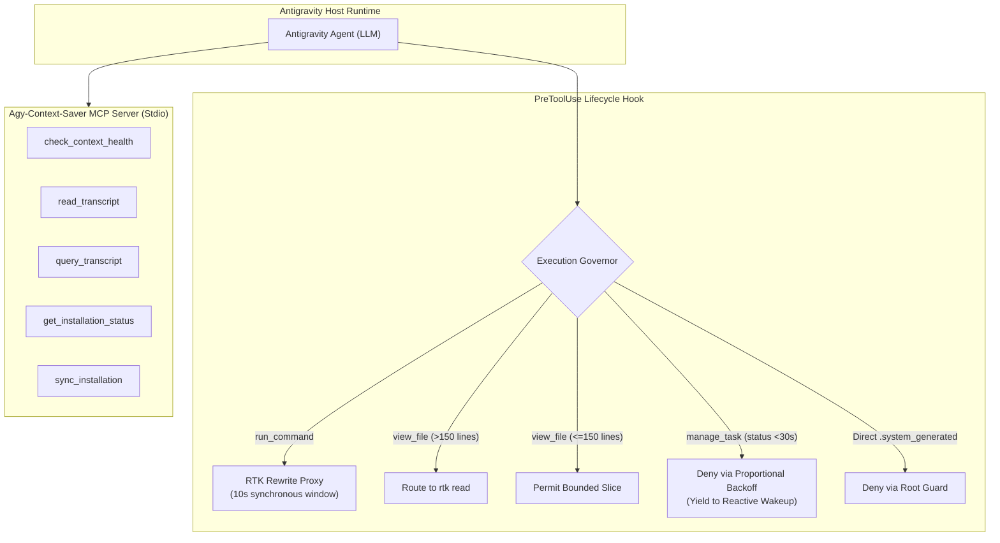
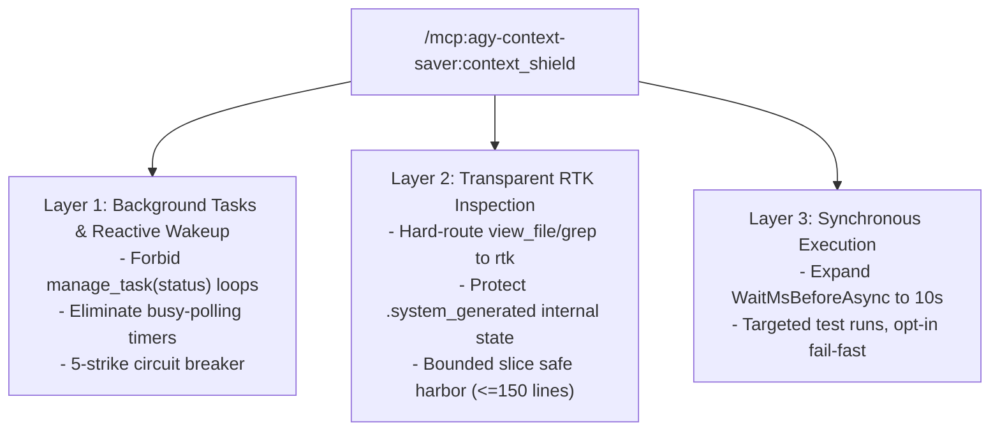

# MCP Tool, Prompt & CLI Reference

`Agy-Context-Saver` provides a unified, zero-dependency Model Context Protocol (MCP) server engineered specifically for **Google Antigravity** (`agy`). It pairs transparent command governance with **RTK (Rust Token Killer)** to eliminate conversational context bloat and ensure reliable multi-agent execution across general developer, research, and operations workloads.

---

## Architectural Division of Responsibilities



The system strictly divides operational responsibilities into two complementary layers:
- **RTK (Rust Token Killer)**: Compresses terminal outputs (`rtk git`, `rtk pytest`, `rtk cargo`), executes canonical workspace searches (`rtk read`, `rtk grep`, `rtk find`), and summarizes stdout.
- **Agy-Context-Saver**: Governs lifecycle turns, prevents runaway polling loops, provides high-density zero-JSON transcript streaming, and audits environmental context health. (Subagent briefs moved to the separate [Agy-Squad](https://paragon-ux.github.io/agy-squad/) package.)

---

## Canonical Codebase Inspection via RTK

Native inspection tools (`view_file`, `grep_search`, `find_by_name`, `list_dir`) bypass token filtering and dump raw text into model context. The `Agy-Context-Saver` PreToolUse hook intercepts these operations and guides agents to canonical RTK commands:

| Native Tool | Target / Arguments | Canonical Governed RTK Command | Token Savings |
| :--- | :--- | :--- | :---: |
| `view_file` | Entire file or $>150$ lines | `rtk read <file>` | **60–85%** |
| `grep_search` | Search pattern & target | `rtk rg "<pattern>" .` *(Win)* / `rtk grep "<pattern>"` *(POSIX)* | **70–90%** |
| `find_by_name` | Filename pattern | `rtk find <path>` | **75–92%** |
| `list_dir` | Directory path | `rtk find <path>` *(Win)* / `rtk ls <path>` *(POSIX)* | **65–88%** |

!!! tip "Bounded Slice Safe Harbor"
    Targeted inspections using native `view_file` with explicit `StartLine` and `EndLine` parameters ($\le 150$ lines total) are permitted directly to allow instant surgical inspection of functions, classes, and specific diff spans without triggering denials.

---

## 1. `check_context_health`

Inspects the active conversation trajectory (`transcript.jsonl`) via streaming chunk readers to audit turn count, payload weight, busy-polling loops, and context degradation risk.

### Parameter Reference

| Parameter | Type | Required | Description |
| :--- | :---: | :---: | :--- |
| `transcriptPath` | `string` | No | Absolute path to `transcript.jsonl`. If omitted, automatically resolves the active session. |
| `conversationId` | `string` | No | Conversation UUID or brain folder name (alternative to `transcriptPath`). |

### Example Invocations

**Audit active session context health (zero parameters):**
```json
{
  "name": "check_context_health",
  "arguments": {}
}
```

**Audit specific historical conversation by UUID:**
```json
{
  "name": "check_context_health",
  "arguments": {
    "conversationId": "68cbb7bc-ce63-4be7-accb-b0e3d37f8ecc"
  }
}
```

### Structured Output Format

The output is structured into two explicitly labeled sections to eliminate metric ambiguity:

```markdown
### Context Health Report: HEALTHY

#### [Active Session Metrics]
- Total Steps: 1140
- User Turns: 18
- Assistant Responses: 563
- Tool Calls: 519
- Detected Busy-Polling Events: 0
- Approximate Raw Transcript Size: 1748.8 KB

#### [Local RTK Environment]
- RTK Command Optimizer: Active (rtk 0.50.0)
- Note: Lifetime token gains from 'rtk gain' represent cumulative machine-wide host savings, not single-session metrics.

✓ Context footprint is well-managed.
```

### Diagnostic Triage Playbook

| Health Status | Trigger Condition | Operational Implication & Corrective Action |
| :--- | :--- | :--- |
| **`HEALTHY`** | Polling $= 0$, User turns $< 35$ | Context footprint is lean and well-windowed. Proceed normally. |
| **`WARNING`** | User turns $\ge 35$ | Turn budget approaching saturation. Summarize progress and continue in a fresh conversation to preserve context. |
| **`CRITICAL`** | Busy-polling events $> 3$ | Active runaway polling detected (`manage_task status` or tight watchdog timers). Immediately halt polling loops and yield execution to native Reactive Wakeup (`<SYSTEM_MESSAGE>`). |

---

## 2. `read_transcript`

Streams conversation turns from Antigravity trajectory logs directly into clean, formatted Markdown dialogue without exposing raw JSON syntax or bloated transport wrappers.

### Parameter Reference

| Parameter | Type | Required | Default | Description |
| :--- | :---: | :---: | :---: | :--- |
| `conversationId` | `string` | **Yes** | — | Target conversation UUID or absolute path to transcript. |
| `mode` | `string` | No | `"compact"` | Format mode: `"compact"` (reads compact `transcript.jsonl`) or `"full"` (reads un-truncated `transcript_full.jsonl`). |
| `lastTurns` | `number` | No | `3` | Number of most recent turns to return (`0` for all retained turns). |
| `includeThinking` | `boolean` | No | `false` | Whether to render the assistant's extended thinking / chain-of-thought blocks. |

### Example Invocation

```json
{
  "name": "read_transcript",
  "arguments": {
    "conversationId": "68cbb7bc-ce63-4be7-accb-b0e3d37f8ecc",
    "mode": "compact",
    "lastTurns": 2,
    "includeThinking": false
  }
}
```

### Sample Output

```markdown
# Conversation Transcript: `68cbb7bc-ce63-4be7-accb-b0e3d37f8ecc`
- Mode: **compact**
- Showing last 2 turn(s)

---
### Turn 17: User
Check context health first, before we continue.

---
### Turn 18: Assistant
Audited context health: Active session is HEALTHY (0 busy-polling loops, 18 user turns). Proceeding with orchestration evaluation.
```

### Operating Guidance: `compact` vs. `full`
- **Use `compact` (Default)**: Best for standard catch-up, peer agent review, and context summarization. Automatically handles truncated fields without pulling megabytes of uncompressed payloads into active context.
- **Use `full`**: Use only when inspecting raw code diffs or large tool outputs that were truncated in the compact transcript. Always pair with a tight `lastTurns` limit ($\le 2$).

---

## 3. `query_transcript`

A multi-mode forensic search engine and surgical step dereferencer across conversation trajectories. Enables finding historical tool calls, searching user directives, and surgically dereferencing specific truncated payload fields.

### Parameter Reference

| Parameter | Type | Required | Default | Description |
| :--- | :---: | :---: | :---: | :--- |
| `conversationId` | `string` | **Yes** | — | Conversation UUID or transcript file path. |
| `query` | `string` | No | `""` | Case-insensitive keyword or substring to filter steps. |
| `roles` | `array` | No | `["user", "assistant"]` | Roles to filter: `"user"`, `"assistant"`, `"tool"`, `"error"`, or `["all"]`. |
| `mode` | `string` | No | `"auto"` | Retrieval mode: `"auto"` (auto-dereferences truncated steps), `"compact"`, or `"full"`. |
| `startStep` | `number` | No | — | Start `step_index` boundary (inclusive). |
| `endStep` | `number` | No | — | End `step_index` boundary (inclusive). |
| `lastTurns` | `number` | No | — | Limit matching steps to the last N conversation turns. |
| `includeThinking` | `boolean` | No | `false` | Whether to include internal model thinking blocks in output. |
| `includeToolCalls` | `boolean` | No | `false` | Whether to include tool call arguments and results in output. |
| `maxResults` | `number` | No | `5` | Maximum matching entries to return. |
| `summaryOnly` | `boolean` | No | `false` | When `true`, formats results as 1-line bullet summaries. |
| `stepIndex` | `number` | No | — | Exact step index to dereference un-truncated from `transcript_full.jsonl`. |
| `field` | `string` | No | — | Optional field projection when `stepIndex` is provided (`"content"`, `"thinking"`, `"tool_calls"`). |

### Query Modes & Examples

#### Mode A: Keyword & Role Filtering
Search for specific error messages or tool calls across history without reading full transcripts:

```json
{
  "name": "query_transcript",
  "arguments": {
    "conversationId": "current",
    "query": "verification failed",
    "roles": ["tool", "assistant"],
    "maxResults": 3
  }
}
```

#### Mode B: Compact 1-Line Summary (`summaryOnly: true`)
Provides ultra-dense timeline summaries for high-level orientation:

```json
{
  "name": "query_transcript",
  "arguments": {
    "conversationId": "current",
    "summaryOnly": true,
    "maxResults": 5
  }
}
```

*Sample Output:*
```markdown
## Transcript Query Summary: `68cbb7bc-ce63-4be7-accb-b0e3d37f8ecc`
- [Step 1138] (assistant) Ran npm test across 8 test suites.
- [Step 1139] (tool) Full test suite passed 100%.
- [Step 1140] (assistant) Formulated roadmap synthesis.
```

#### Mode C: Surgical Step Dereferencing (`stepIndex` & `field`)
When a compact transcript indicates `truncated_fields: ["content"]`, recover the exact content field without reading adjacent steps:

```json
{
  "name": "query_transcript",
  "arguments": {
    "conversationId": "current",
    "stepIndex": 1139,
    "field": "content"
  }
}
```

*Sample Output:*
```markdown
### Step 1139 Content:
ALL 8 AUTOMATED TEST SUITES PASSED 100%!
✓ test-hook.mjs (28/28 passed)
✓ test-mcp.mjs (15/15 passed)
✓ test-output-governance.mjs (12/12 passed)
```

---

## 4. `get_installation_status`

Performs an instant live audit of the 4 integration layers and the RTK binary directly from inside an Antigravity agent or user session.

### Parameter Reference
*(None — operates with empty arguments `{}`)*

### Example Invocation

```json
{
  "name": "get_installation_status",
  "arguments": {}
}
```

### Structured Output Format

```markdown
### Agy-Context-Saver Installation Status: HEALTHY & ACTIVE 🛡️
- Native Plugin Link: ACTIVE (C:\Users\USER\.gemini\config\plugins\agy-context-saver)
- Governor Lifecycle Hook: REGISTERED in hooks.json (Script: Present)
- Universal MCP Server: CONFIGURED in mcp_config.json
- Antigravity Tool Schemas: ALL 5 SCHEMAS PRESENT (C:\Users\USER\.gemini\antigravity\mcp\agy-context-saver)
- RTK Binary: INSTALLED (rtk 0.50.0)
- RTK Hook Optimization: ACTIVE (via PreToolUse)

✓ All Antigravity integration layers and RTK optimizer are fully operational.
```

---

## 5. `sync_installation`

Programmatically reconciles, repairs, and updates all installation layers (Plugin link, Lifecycle Hook, MCP config, and mirrored Antigravity tool schemas) in $<150\text{ ms}$.

### Parameter Reference

| Parameter | Type | Required | Default | Description |
| :--- | :---: | :---: | :---: | :--- |
| `checkOnly` | `boolean` | No | `false` | If `true`, runs pre-flight validation dry-run without writing changes to disk. |

### Example Invocations

**Dry-run pre-flight check:**
```json
{
  "name": "sync_installation",
  "arguments": { "checkOnly": true }
}
```

**Live repair and synchronization:**
```json
{
  "name": "sync_installation",
  "arguments": {}
}
```

### Structured Output Format

```markdown
### Agy-Context-Saver Installation Synchronization
- Status: SYNCHRONIZED & HEALTHY 🛡️
- Elapsed Time: 135.3 ms
- Plugin Link: Verified
- Lifecycle Hook: Registered in hooks.json
- MCP Server: Registered in mcp_config.json
- Tool Schemas: 5 Schemas mirrored to ~/.gemini/antigravity/mcp/agy-context-saver
- RTK Binary: Verified (rtk 0.50.0)

✓ Installation fully synchronized and up-to-date in Zero-Delay mode.
```

---

## Ephemeral Spillover & Task Log Safe Harbors (0 New Tools)

Rather than introducing redundant MCP tools that inflate schema overhead and induce LLM tool confusion, `Agy-Context-Saver` leverages canonical tools coupled with PreToolUse governance safe-harbors:

### 1. Step Output Spillovers
When tool outputs exceed inline thresholds ($>24\text{ KB}$), Antigravity spills them to `.system_generated/steps/<step>/output.txt`.
- **Governance**: Native `view_file` or shell `cat` invocations on spillover paths are automatically routed to `rtk read <path>`.
- **Optimization**: `rtk read` automatically applies line windowing, head/tail clamping, and token reduction with zero manual configuration.

### 2. Completed Background Task Logs
When detached tasks finish, full logs reside in `.system_generated/tasks/<taskId>.log`.
- **While RUNNING**: Reading task logs is strictly **DENIED** under the Proportional Backoff curve, eliminating busy-polling loops.
- **When COMPLETED**: Inspecting completed task logs is safe-harbored via `rtk read tasks/<taskId>.log` via `run_command`, enabling post-mortem stack trace inspection.

### 3. Permanently Retired Tools (Superseded by PreToolUse Proxies)
To eliminate tool registry bloat and agent hesitation, legacy tools from earlier versions are permanently retired and cleanly purged:
- **`safe_command`** *(Retired in v1.2.0)*: Replaced by transparent PreToolUse hook rewriting of native `run_command` via RTK (`rtk git`, `rtk pytest`, etc.) and synchronous window expansion to 10s. Invocations return JSON-RPC error `-32601` (*Tool not found*).
- **`get_spillover_content` & `read_task_output`** *(Retired in v1.5.0)*: Replaced by the zero-new-tools safe-harbor pattern routing `view_file` to `rtk read`.
- **`get_step_detail`** *(Retired in v1.5.0)*: Consolidated surgically into `query_transcript(stepIndex, field)`.

---

## MCP Prompts (`/mcp:...`): User Slash Commands

MCP Prompts appear directly in Antigravity chat autocomplete menus as user-triggerable slash commands.

### `/mcp:agy-context-saver:context_shield`

* **Prompt Name**: `context_shield`
* **Trigger**: Type `/mcp:agy-context-saver:context_shield` in chat or select from autocomplete.
* **Purpose**: Instantly injects the complete 3-layer context governance rules into any active session.

#### Governance Rules Injected by `context_shield`



1. **Layer 1 (Background Tasks & Reactive Wakeup)**: Enforces native notification resumption (`<SYSTEM_MESSAGE>`). Repeated polling attempts trip a `force_ask` circuit breaker at 5 denials.
2. **Layer 2 (Transparent Shell & RTK Inspection)**: Hard-routes full file reads to `rtk read`, directory scans to `rtk find`, and searches to `rtk rg "<pattern>" .`.
3. **Layer 3 (Synchronous Execution)**: Extends default command execution wait windows to 10,000ms.
